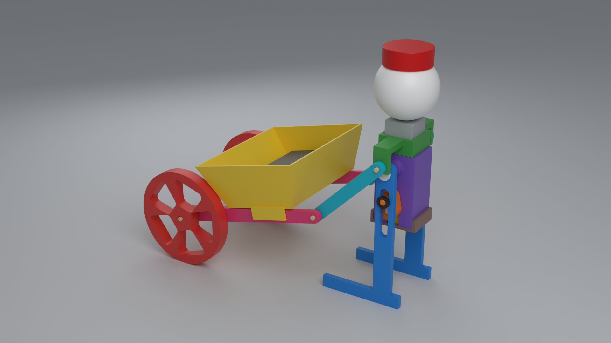
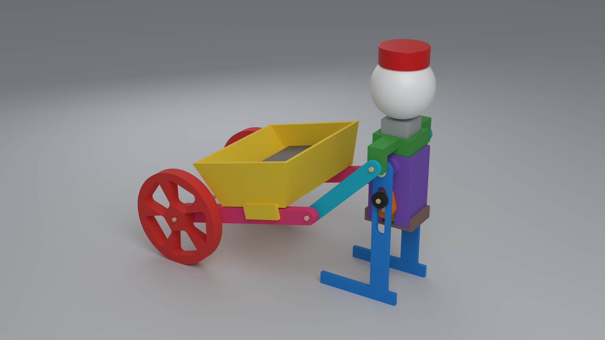
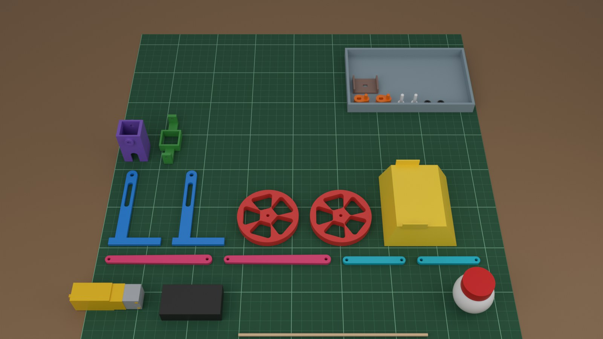
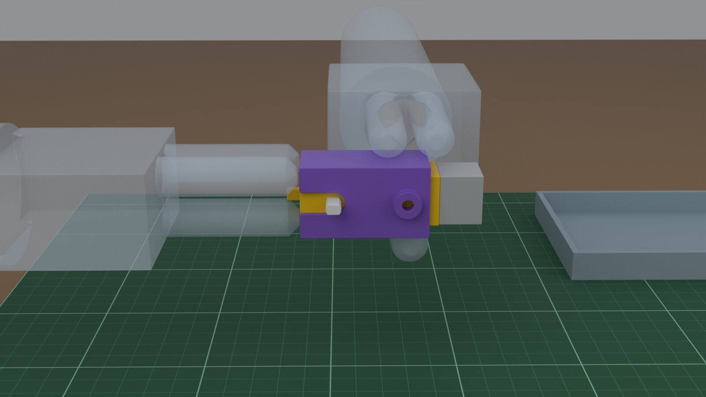
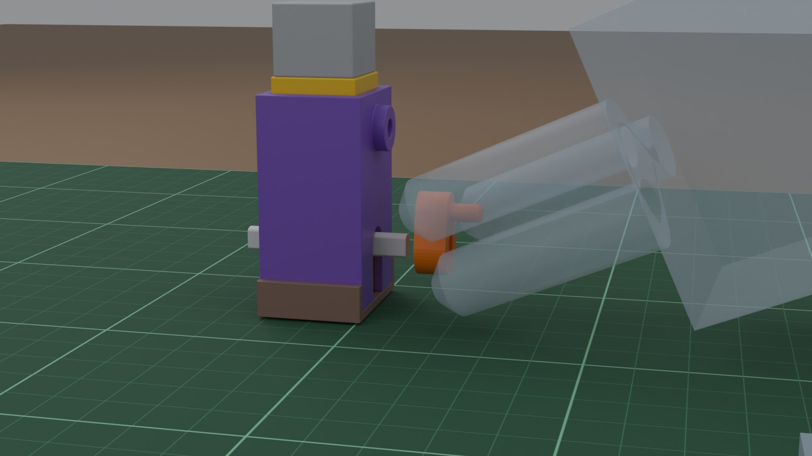
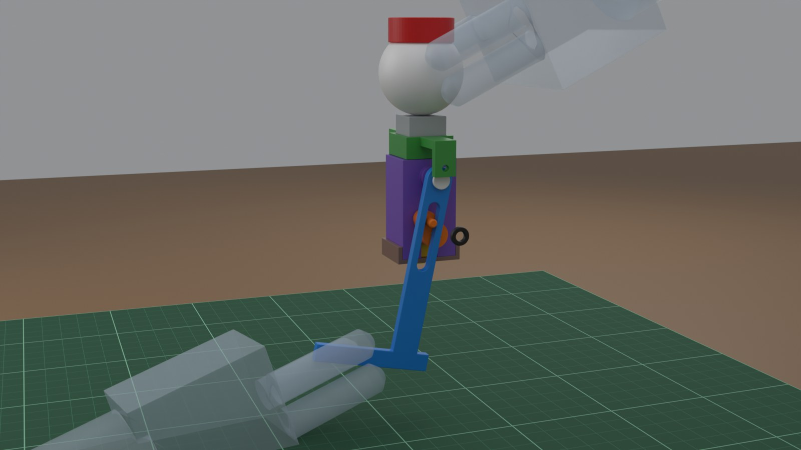
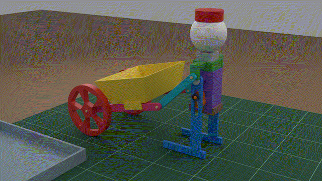

# Printed Wheelbarrow Walker

A small walking robot that pushes a wheelbarrow, driven by one TT gear motor. Two complete builds from one design:

- **Full 3D print**: 11 parts in [`stl/`](stl/), no supports, every part fits a 180 × 180 mm bed. Settings and fits: [`print.md`](print.md).
- **Full cardboard**: the same parts cut from 3 mm corrugated card. Print [`cardboard/templates.pdf`](cardboard/templates.pdf) at **100 % / actual size** (check the 100 mm bar).

Bought for both: a TT gear motor (double shaft, 3–6 V), a 2×AA battery holder with switch, a 3 mm skewer, a ping-pong ball and a bottle cap. The motor and holder attach without glue (see `print.md`).

| Full 3D print | Full cardboard |
|---|---|
|  |  |

Building with kids: a grown-up does knife cuts, hot glue and soldering. Small parts (pegs, caps) are a choking hazard for under-3s.

Mechanism: pendulum legs driven by cranks 180° apart (8 mm crank, hip 26 mm above the shaft). Stride 54.2 mm, foot lift 4.3 mm, checked for clashes at 8 crank angles.

License: MIT.

## Assembly preview

**Video sample (20 s):** [preview/assembly-sample.mp4](preview/assembly-sample.mp4) — motor into cradle, clip, crank, leg + peg + cap, then it walks.

Workbench renders of the first build steps (lift → align → fit → check). Hands are translucent so the joint stays visible.

| Kit | Motor into cradle | Crank onto shaft | Hang a leg |
|---|---|---|---|
|  |  |  |  |

